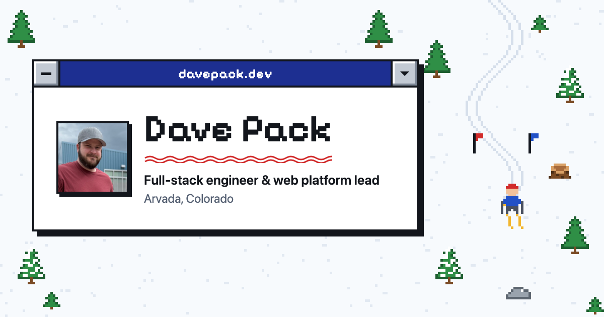

# davepack.dev

My personal site: a resume you can explore, set on a retro ski slope.

**Live:** [davepack.dev](https://davepack.dev)

[](https://davepack.dev)

A SkiFree-style pixel game plays behind the page, and the content lives in Windows 3.1-style windows you can drag, minimize to desktop icons, and reopen. Pick a skill to filter the jobs and projects that used it, then open one to read the details. It's built on Remix 3 and Cloudflare Workers, and it all works with JavaScript turned off.

## Highlights

- **Progressive enhancement first.** The page is server-rendered, and its interactions are plain HTML and CSS: skill filtering and tabs are radio buttons styled with `:has()`, and detail windows are native `<dialog>`s opened with invoker commands. JavaScript adds motion and the desktop on top.
- **Remix 3 client entries.** The draggable window title bars and desktop icons are hydrated components that share a small, unit-tested desktop model. Dragging is a custom `createMixin` gesture that works with mouse and touch.
- **View Transitions.** Cards grow into their windows and windows shrink into desktop icons, with workarounds for two Chrome quirks: fixed elements disappearing during a transition while scrolling is locked, and permanently named elements drawing over an opening dialog.
- **A canvas game with an autopilot.** The background skier reads the page's window positions and steers into the open snow beside them, and it occasionally skis into an obstacle on purpose. The game pauses for visitors who prefer reduced motion, and "Play game" hands over the controls.
- **Privacy-respecting analytics.** Interaction events go to Workers Analytics Engine through a validated `POST /events` route: no cookies, no identifiers, and nothing sent at all when the browser signals Global Privacy Control or Do Not Track. A separate local Remix app on Node reads them back as a dashboard.
- **Resume data with guardrails.** Everything comes from one JSON file through a single module that never exposes contact details and drops any entry not yet verified.
- **Small and fast.** One Worker, no framework on the client beyond the Remix component runtime, pixel art drawn from data, and link-preview images generated with headless Chrome.

## How it was built

I designed and built this site with [Claude Code](https://claude.com/claude-code), the same AI-native workflow I use daily at work: I set the direction and make the calls, and Claude implements, tests in a real browser, and reviews alongside me. The commit history shows the process.

## Architecture

| Path                                          | What lives there                                                                                            |
| --------------------------------------------- | ----------------------------------------------------------------------------------------------------------- |
| `worker.ts`, `app/router.ts`, `app/routes.ts` | Worker entry, router, and the route contract                                                                |
| `app/actions/`                                | Server-rendered page sections, the controller, the `/events` route, and SEO metadata                        |
| `app/actions/public/`                         | Browser code: the Remix client entries, desktop model, drag mixin, and analytics client, bundled by esbuild |
| `app/data/resume.ts`                          | The only reader of `data/davepack-resume.json`                                                              |
| `public/`                                     | Static assets, plus plain scripts for the ski game, skill-card motion, and theme cookie                     |
| `tools/dashboard/`                            | Local-only analytics dashboard (Remix on Node, never deployed)                                              |
| `scripts/`                                    | Client bundle build, image generation, and analytics queries                                                |

## Running it

Requires Node 24 and a Cloudflare account for deploys.

```sh
npm i
npm run dev          # local Worker (builds the client bundle first)
npm test             # unit tests
npm run typecheck
npm run lint
npm run deploy       # build and deploy to Cloudflare Workers
npm run images       # regenerate the link-preview image and icons
npm run dashboard    # local analytics dashboard (needs a read token in .env.events)
```

Contributor conventions are in [AGENTS.md](AGENTS.md).
